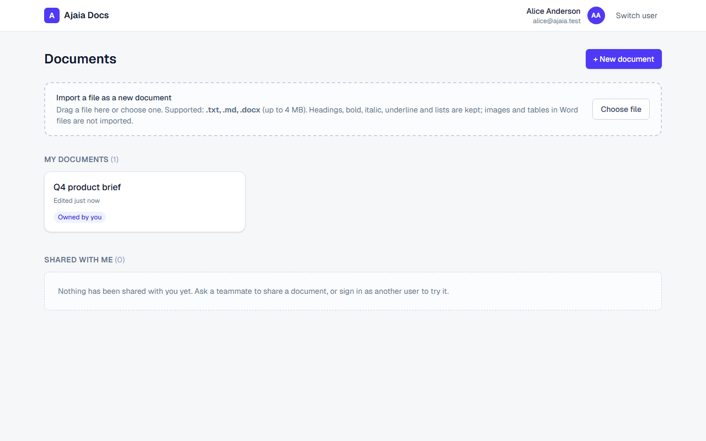
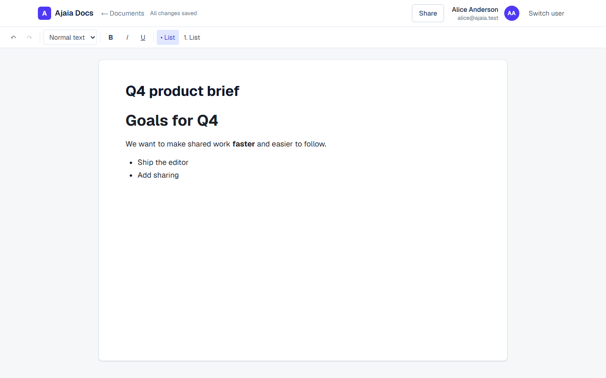
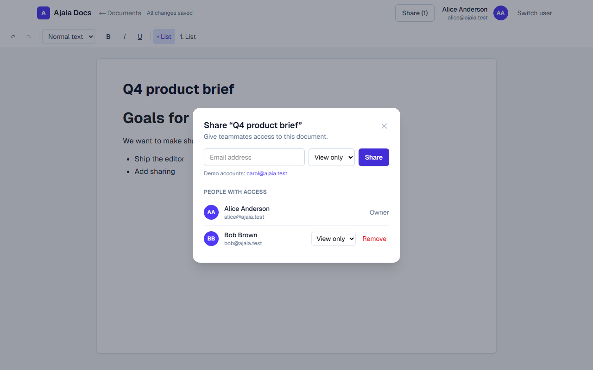

# Ajaia Docs

A lightweight collaborative document editor inspired by Google Docs. Create and rename documents, edit with
rich-text formatting, import files, share with teammates (viewer or editor), and keep everything persisted.

**Stack:** Next.js 16 + React 19 + TypeScript + Tailwind (frontend) · FastAPI + SQLAlchemy (backend) ·
TipTap editor · Postgres (Neon) in production, SQLite locally.

## Try it (live)

| | |
|---|---|
| **App** | https://ajaia-docs-olive.vercel.app |
| API | https://ajaia-docs-five-psi.vercel.app (interactive docs at `/docs`) |

No passwords. On the sign-in screen, pick one of the seeded demo accounts:

| Email | Name |
|---|---|
| alice@ajaia.test | Alice Anderson |
| bob@ajaia.test | Bob Brown |
| carol@ajaia.test | Carol Chen |

### 2-minute review path (shows every requirement)

1. Sign in as **Alice** → **+ New document**. Rename it (title at the top), then try bold / italic / underline,
   Heading 1–3, bulleted and numbered lists. Watch the header: *Saving… → All changes saved*. Refresh the page; it's all still there.
2. Back on the dashboard, **import a file** (drag in or *Choose file*): a `.txt`, `.md` or `.docx` becomes a new editable document.
3. In a document, click **Share**, add `bob@ajaia.test` as **View only**.
4. Click **Switch user**, sign in as **Bob**. The document appears under **Shared with me** ("Shared by Alice Anderson", "View only"). Opening it shows a read-only editor.
5. Sign back in as Alice, change Bob to **Can edit**. As Bob, you can now edit, and Alice sees the change.
6. Sign in as **Carol** and open Alice's document URL: you get "Document not found" (no access).

The first request after the site has been idle can take a few seconds (serverless cold start).

## Features

- **Documents:** create, rename, edit, autosave, reopen. Formatting is preserved (stored as sanitized HTML).
- **Editor:** bold, italic, underline, Heading 1/2/3, bulleted and numbered lists, undo/redo.
- **File import** → new editable document you own:

  | Type | Behavior |
  |---|---|
  | `.txt` | Blank-line-separated paragraphs; single line breaks preserved |
  | `.md` / `.markdown` | Headings, bold, italic, lists, quotes. Raw HTML inside Markdown is shown as plain text, never executed |
  | `.docx` | Headings, bold, italic, underline, lists. **Images and tables are not imported** |

  Max **4 MB** (Vercel caps request bodies at ~4.5 MB). Other types are rejected with a message listing the supported ones.
- **Sharing:** owner shares by email as *viewer* or *editor*; change roles or revoke anytime. The dashboard separates
  **My documents** from **Shared with me** with owner and permission badges. Permissions are enforced on the server.
- **Quality:** input validation and consistent error messages, retry-safe autosave, unsaved-changes warning,
  44 API tests + browser end-to-end tests.

## Local setup

Requires **Node 20+** and **Python 3.11+**. No database server needed locally (SQLite).

```bash
npm run setup   # one time: venv + dependencies + .env files + demo users
npm run dev     # API on :8000 and web on :3000 together (Ctrl+C stops both)
```

Then open http://localhost:3000. Works the same on Windows, macOS and Linux. `npm run setup` is safe to
re-run: it never overwrites existing `.env` files.

### Environment files

| File | Purpose | Created by |
|---|---|---|
| `apps/api/.env` | `DATABASE_URL` (local SQLite), `JWT_SECRET`, `COOKIE_SECURE`, … | `setup` (copies `.env.example`, generates a random `JWT_SECRET`) |
| `apps/web/.env.local` | `API_URL`, where Next proxies `/api/*` (default `http://127.0.0.1:8000`) | `setup` (copies `.env.example`) |

Real env files are git-ignored; the `.env.example` files document every variable. The web app proxies `/api/*` to
the API, so the session cookie stays same-origin and no CORS setup is needed.

<details>
<summary>Manual setup (what <code>npm run setup</code> does)</summary>

```bash
cd apps/api
python -m venv .venv
.venv/bin/pip install -r requirements-dev.txt      # Windows: .venv\Scripts\pip
cp .env.example .env                               # then set JWT_SECRET to a long random value
cd ../web && npm install && cp .env.example .env.local && cd ../..
npm run seed                                       # tables + demo users
npm run dev:api                                    # terminal 1
npm run dev:web                                    # terminal 2
```

</details>

## Tests

```bash
npm run test:api   # pytest, 44 tests: access matrix, sharing, sanitization, import, validation, config
npm run test:e2e   # Playwright, 3 flows in a real browser (first run: npx --prefix apps/web playwright install chromium)
```

The e2e run builds the web app and starts its own API (port 8100) and web server (port 3100) on a throwaway
SQLite database, so it never touches your dev data. To run the same tests against a deployment:

```bash
E2E_BASE_URL=https://ajaia-docs-olive.vercel.app npm run test:e2e   # cleans up the documents it creates
```

## Deployment (Vercel + Neon)

Two Vercel projects from this one repo, plus a Neon Postgres database:

| Project | Root Directory | Environment variables |
|---|---|---|
| API | `apps/api` | `DATABASE_URL` (Neon URL, pasted as-is), `JWT_SECRET` (long random), `COOKIE_SECURE=true` |
| Web | `apps/web` | `API_URL` = the API project's URL, no trailing slash |

One-time database setup (creates tables + demo users), run from your machine:

```bash
DATABASE_URL="<neon url>" node scripts/py.mjs -m app.seed      # PowerShell: $env:DATABASE_URL="<neon url>"; npm run seed
```

`API_URL` is read at build time, so redeploy the web project after changing it. If the API returns a Vercel login
page, turn off *Deployment Protection → Vercel Authentication* for the API project.

## Project layout

```
apps/web      Next.js app (components/, lib/, e2e/)
apps/api      FastAPI app (app/{access,auth,models,schemas}.py, routers/, services/, tests/)
scripts/      setup.mjs, dev.mjs, py.mjs (cross-platform helpers)
docs/         screenshots
```

Other useful commands: `npm run seed`, `npm run gen:types` (regenerate frontend API types from the FastAPI
schema), `npm run lint:web`.

## Documents in this repo

- [`ARCHITECTURE.md`](ARCHITECTURE.md): what was built, why, what was cut, what's next
- [`AI_WORKFLOW.md`](AI_WORKFLOW.md): how AI tools were used and how the output was verified
- [`SUBMISSION.md`](SUBMISSION.md): exactly what's included, status, and review credentials

## Status and known limitations

Everything in the brief is implemented and working end to end. Intentionally not built: real-time collaboration
(concurrent edits are last-write-wins), real authentication, version history/comments, images/tables, and
database migrations. See `ARCHITECTURE.md` for the reasoning and what I'd build next.

## Screenshots





More in [`docs/screenshots`](docs/screenshots). Regenerate with `SCREENSHOTS=1 npm run test:e2e -- screenshots`
(Windows PowerShell: `$env:SCREENSHOTS=1; npm run test:e2e -- screenshots`).
